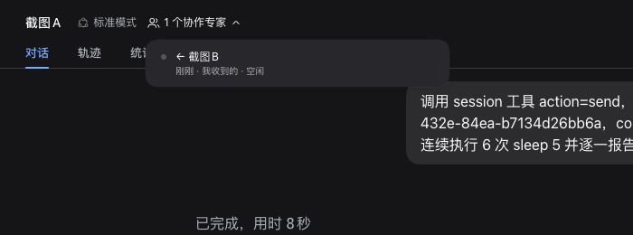
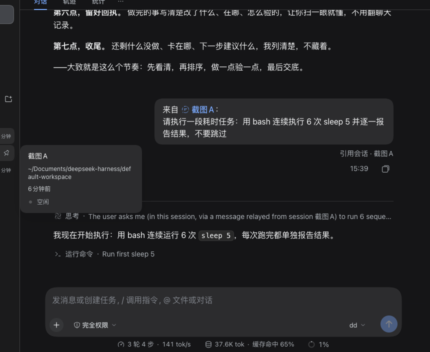
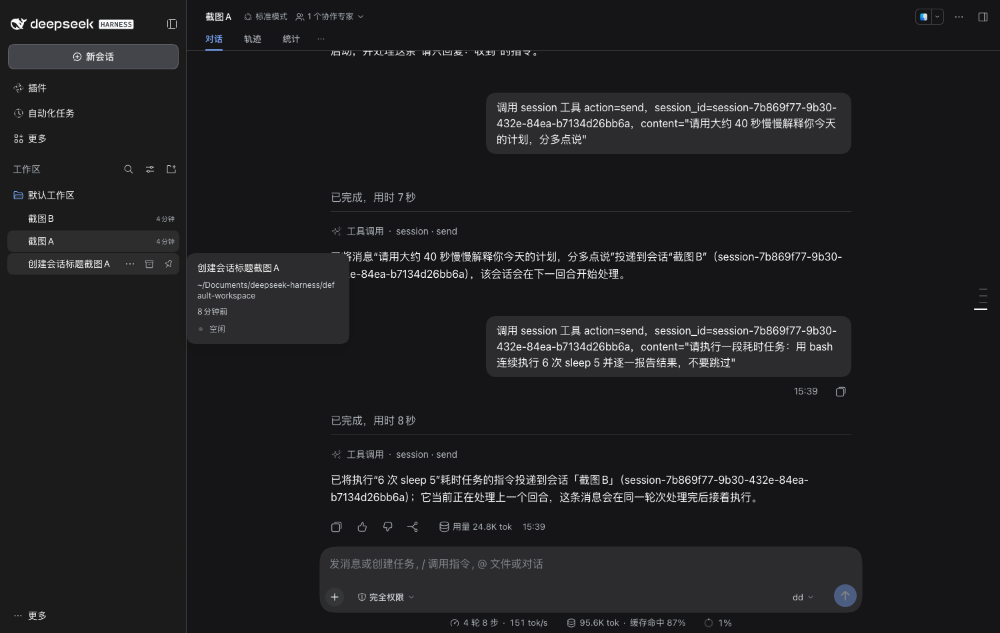

# dsh-session-hub

[DSH](https://github.com/deepseek-ai) 会话中心插件：一个 `session` 工具，读会话清单、逐轮摘要、完整对话，并按 id 新建、改名、发消息、中断、归档、置顶其他会话；会话头部显示**协作专家**往来指示；消息可要求**自动回执**。

无需修改 DSH 源码，安装即用。

## 效果

### 头部协作专家指示

会话头部与「N 个子智能体」并列显示「N 个协作专家」。空闲时是协作图标，有协作会话正在运行时换成转圈（与 DSH 子智能体／后台任务的做法一致，两者互斥不并列）。

<p>
  
  
</p>

### 悬停展开往来会话列表

按最近往来时间倒序，每行显示**方向**（`→` 我发出的 / `←` 我收到的）、会话标题、相对时间与运行状态；点击直接跳转；归档会话保留在列表并标注。



### 会话间发消息与来源标注

发消息时正文首行自动带上发送方的**会话引用**（DSH 原生渲染，可点开），接收方一眼看出「不是用户本人发的」。



### 工具调用

`session` 工具的调用与结果都会出现在会话轨迹里。



## 功能

| 功能 | 说明 |
| --- | --- |
| 会话浏览 | 列表（标题、轮数、来源、归档/置顶）、逐轮摘要、完整对话文本，按关键词搜正文 |
| 会话写操作 | 新建（可同时命名）、改名、发消息、中断、归档、取消归档、置顶、取消置顶 |
| 协作专家指示 | 头部显示「N 个协作专家」，悬停列出往来会话（方向、标题、最近往来、状态），点击跳转 |
| 自动回执 | `send` 传 `receipt: true`，目标会话这一轮自然结束时，最终回复自动发回本会话 |
| 发送方标注 | 消息正文首行是发送方的会话引用标签 |

## 安装

```bash
# 1. 放到本地插件目录（或任意位置）
cp -R dsh-session-hub ~/.dsh-local-plugins/

# 2. 在 profile 的 package.json 挂载
{
  "dependencies": {
    "@local/dsh-session-hub": "link:~/.dsh-local-plugins/dsh-session-hub"
  },
  "dsh": {
    "profile": {
      "bundles": [
        "@deepseek-ai/dsh-base",
        "@deepseek-ai/dsh-web-app",
        "@local/dsh-session-hub"
      ]
    }
  }
}
```

重启 `dsh web` 生效。

> 本仓库的 `package.json` 用公开包名 `dsh-session-hub`；本地挂载时请把 `name`、`cordis.patch.yml` 里的包名、以及 `client.js` 顶部的模块 `id` 统一改成你实际使用的包名（本地习惯用 `@local/dsh-session-hub`）。三者必须一致，否则客户端插件会加载失败。

## session 工具速查

| 参数 | 作用 |
| --- | --- |
| （不传 action） | 只读：列会话清单；传 `session_id` 看逐轮摘要；再传 `mode`（summary/dialog/full）看全文 |
| `action=create` | 新建会话（`title` 可同时命名，`cwd` 指定工作目录） |
| `action=rename` | 改名（`content` 即新标题） |
| `action=send` | 发消息（`content` 必填；`receipt: true` 要求自动回执；跨工作目录需显式传 `cwd`） |
| `action=interrupt` | 中断目标当前轮（保留队列） |
| `action=archive` / `unarchive` | 归档 / 取消归档（归档运行中会话需 `confirm: true`） |
| `action=pin` / `unpin` | 置顶 / 取消置顶 |

## 安全约束

- 不能给子智能体会话发消息（子会话由 subagent 路由持有）。
- 归档会话必须先取消归档才能发消息。
- 发消息默认只允许同一工作目录，跨目录要显式传 `cwd`。
- A→B→A 回环自动拒绝；同一对会话的自动回执每次进程生命周期只回一次（防循环，进程内账本，重启重置）。

## 已知限制

- 循环防护账本是进程内的，宿主重启后同一对会话可再回执一次。
- `receipt` 的自动回执只覆盖目标「正常结束」的轮次；被中断或报错的轮次不回执。
- 归档会话无法直接打开：DSH 对已归档会话不保留会话引用（`is released`），插件改为标注「已归档」并在点击时提示先取消归档，不会擅自改动你的归档状态。

## 目录结构

```
dsh-session-hub/
├── index.js          # session 工具 + 协作专家投影 + 自动回执
├── client.js          # 头部协作专家指示（计数 + 悬停列表）
├── package.json       # 清单（exports、dsh.client 配置）
├── cordis.patch.yml   # bundle 挂载声明
├── locale/            # zh / en 词典
├── docs/
│   ├── DETAIL.md      # 插件详情（英文）
│   ├── DETAIL.zh.md   # 插件详情（中文）
│   └── screenshots/   # 文档截图
└── icon.svg
```

## License

[MIT](LICENSE)
