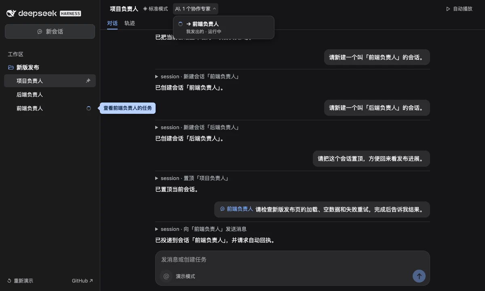
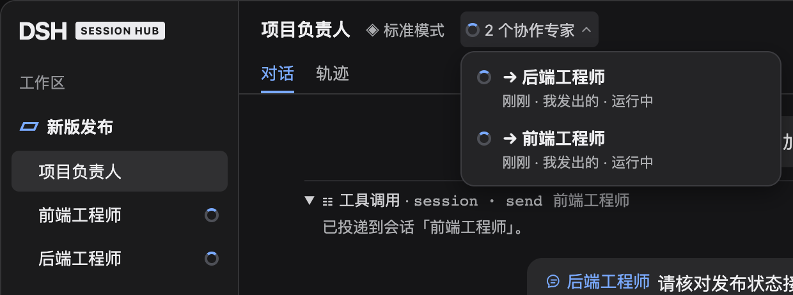
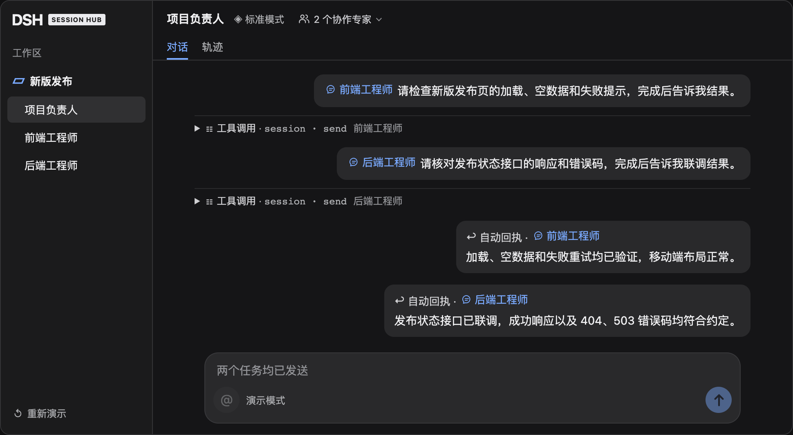
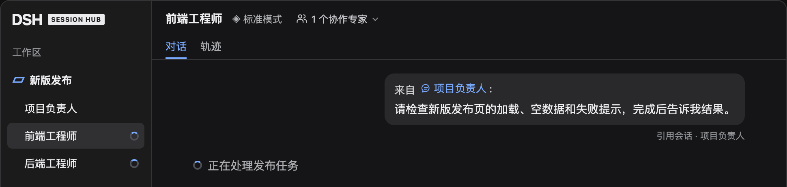
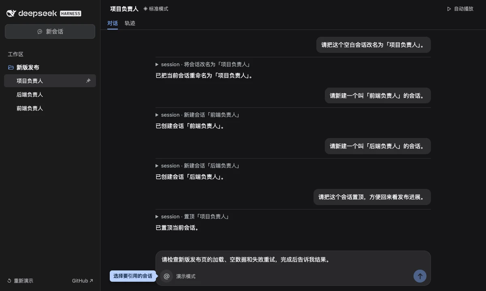
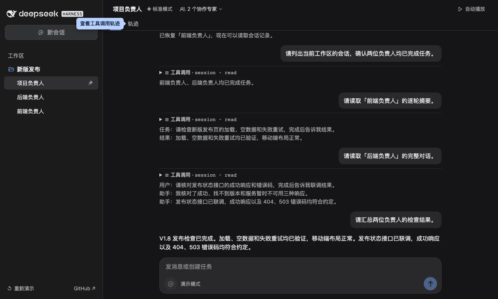
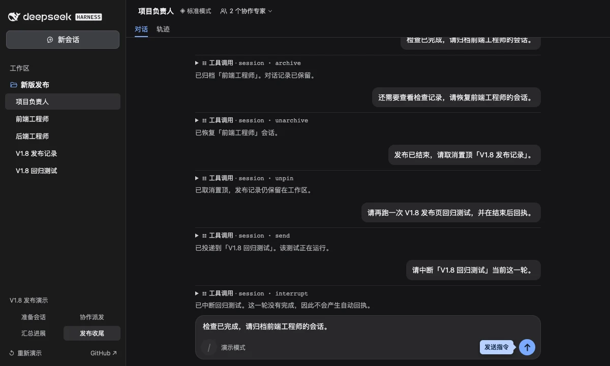
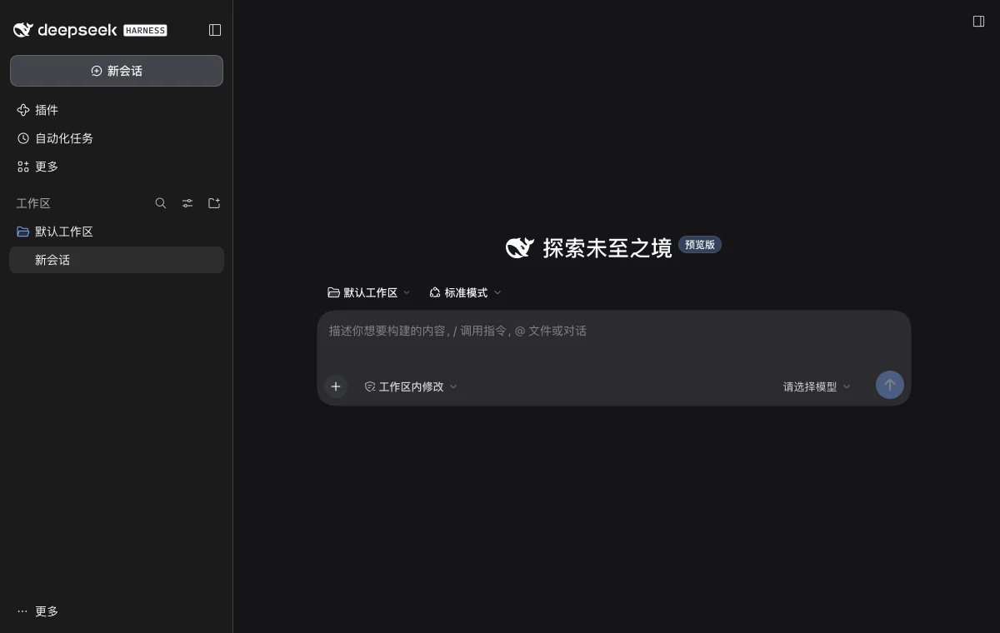

# dsh-session-hub

让 [DSH](https://github.com/deepseek-ai) 会话互相派活，任务完成后把回复自动带回发起会话。插件提供 `session` 工具管理会话，无需修改 DSH 源码。

[](https://duo121.github.io/dsh-session-hub/)

**[打开交互演示 ↗](https://duo121.github.io/dsh-session-hub/)** · 浏览器里的模拟工作区，无需安装 DSH。

## V1.8 发布演示

演示默认打开「协作派发」。侧栏底部可以切换发布阶段，项目负责人会话会保留之前的消息和回执。每个阶段都从同一个输入框发送预设指令，点击 `/` 可以选择其他指令。工具调用可展开查看。

| 章节 | 可以体验的操作 |
| --- | --- |
| 准备会话 | 新建发布记录会话，添加版本号并置顶。会话标题和顺序会在侧栏更新。 |
| 协作派发 | 向前后端工程师分别派发任务，从自动展开的协作专家列表进入目标会话，再回到负责人处收取回执。 |
| 汇总进展 | 列出工作区会话，读取两位工程师的逐轮摘要或完整对话，汇总发布检查结果。 |
| 发布收尾 | 归档和恢复已完成的会话，取消置顶发布记录，并体验中断测试后不产生回执的分支。 |

### 一次发布，三个协作会话

**1. 分别发送任务。** 项目负责人 `@前端工程师` 检查发布页的状态提示，再 `@后端工程师` 核对接口响应。`@` 把会话引用插入输入框，供智能体读取上下文。智能体调用 `session` 的 `action=send` 后，任务才会进入目标会话。

**2. 查看协作专家。** 演示里每次发送后，头部的协作专家列表会自动展开。两个任务发出后，负责人会话显示「2 个协作专家」。列表里可以查看各自的运行状态，点击名字就能切到对应会话。



**3. 回到负责人会话收结果。** 两位工程师各自正常结束后，最终回复会自动回到项目负责人会话。回执上的会话引用可以点开，查看对应任务。



<details>
<summary>查看接收方看到的消息</summary>

消息首行标明「来自 项目负责人」。点击引用可以跳回来源会话。



</details>

<details>
<summary>查看发布准备、进展汇总和收尾截图</summary>

**准备会话。** 新建、改名并置顶发布记录，侧栏同步显示新标题和顺序。



**汇总进展。** 使用 `session · read` 读取两位工程师的对话，再汇总前端页面检查与后端接口联调结果。



**发布收尾。** 归档后可以恢复会话。被中断的测试轮次没有正常完成，因此不产生自动回执。



</details>

<details>
<summary>查看原版 DeepSeek Harness 界面参考</summary>

演示的品牌区、会话布局、协作专家列表和引用选择器分别参考了原版截图。[工作区与输入框](docs/screenshots/harness-reference.webp) · [会话与工具调用](docs/screenshots/tool-call.webp) · [协作专家列表](docs/screenshots/menu-open.webp) · [会话引用选择器](docs/screenshots/at-picker.webp)



</details>

## 功能

| 功能 | 说明 |
| --- | --- |
| 会话浏览 | 列表（标题、轮数、来源、归档/置顶）、逐轮摘要、完整对话文本，按关键词搜正文 |
| 会话写操作 | 新建（可同时命名）、改名、发消息、中断、归档、取消归档、置顶、取消置顶 |
| 协作专家指示 | 头部显示「N 个协作专家」，悬停列出往来会话（方向、标题、最近往来、状态），点击跳转 |
| 自动回执 | `send` 传 `receipt: true`，目标会话这一轮自然结束时，最终回复自动发回本会话 |
| 发送方标注 | 消息正文首行是发送方的会话引用标签 |

## 安装

```bash
# 1. 放到本地插件目录（或任意位置）
cp -R dsh-session-hub ~/.dsh-local-plugins/

# 2. 在 profile 的 package.json 挂载
{
  "dependencies": {
    "@local/dsh-session-hub": "link:~/.dsh-local-plugins/dsh-session-hub"
  },
  "dsh": {
    "profile": {
      "bundles": [
        "@deepseek-ai/dsh-base",
        "@deepseek-ai/dsh-web-app",
        "@local/dsh-session-hub"
      ]
    }
  }
}
```

重启 `dsh web` 生效。

> 本仓库的 `package.json` 用公开包名 `dsh-session-hub`；本地挂载时请把 `name`、`cordis.patch.yml` 里的包名、以及 `client.js` 顶部的模块 `id` 统一改成你实际使用的包名（本地习惯用 `@local/dsh-session-hub`）。三者必须一致，否则客户端插件会加载失败。

## session 工具速查

`action` 必填。原先省略 `action` 的调用需要显式传 `action: "read"`。

| 参数 | 作用 |
| --- | --- |
| `action=read` | 只读：列会话清单（可传 `query` 粗筛）；传 `session_id` 看逐轮摘要；再传 `mode`（summary/dialog/full）看全文 |
| `action=create` | 新建会话（`title` 可同时命名，`cwd` 指定工作目录）。注意：同一工作区里若已有**没开始过回合**的空白会话，控制器会直接复用那个（结果里会明确提示「复用了已有的空白会话」），不会多出一个新会话 |
| `action=rename` | 改名（`content` 即新标题） |
| `action=send` | 发消息（`content` 必填；`receipt: true` 要求自动回执；跨工作目录需显式传 `cwd`） |
| `action=interrupt` | 中断目标当前轮（保留队列） |
| `action=archive` / `unarchive` | 归档 / 取消归档（归档运行中会话需 `confirm: true`） |
| `action=pin` / `unpin` | 置顶 / 取消置顶 |

## 安全约束

- 不能给子智能体会话发消息（子会话由 subagent 路由持有）。
- 归档会话必须先取消归档才能发消息。
- 发消息默认只允许同一工作目录，跨目录要显式传 `cwd`。
- **不能发给自己**：自己不是自己的协作专家，`send` 到本会话会被直接拒绝，也不计入协作专家列表。
- A→B→A 回环自动拒绝；同一对会话的自动回执每次进程生命周期只回一次（防循环，进程内账本，重启重置）。

## 已知限制

- 循环防护账本是进程内的，宿主重启后同一对会话可再回执一次。
- `receipt` 的自动回执只覆盖目标「正常结束」的轮次；被中断或报错的轮次不回执。
- 归档会话无法直接打开：DSH 对已归档会话不保留会话引用（`is released`），插件改为标注「已归档」并在点击时提示先取消归档，不会擅自改动你的归档状态。

## 目录结构

```
dsh-session-hub/
├── index.js          # session 工具 + 协作专家投影 + 自动回执
├── client.js          # 头部协作专家指示（计数 + 悬停列表）
├── package.json       # 清单（exports、dsh.client 配置）
├── cordis.patch.yml   # bundle 挂载声明
├── locale/            # zh / en 词典
├── docs/
│   ├── DETAIL.md      # 插件详情（英文）
│   ├── DETAIL.zh.md   # 插件详情（中文）
│   └── screenshots/   # 文档截图
└── icon.svg
```

## 联系与交流

用的时候遇到问题、有想法想聊，或者想看看别人怎么用，都欢迎来交流。

- **微信**：`jianduo1`（加我时说一声 `dsh-session-hub`，方便我备注）
- **智能体交流群**：加微信后我拉你进群，一起聊 DSH 插件、跨会话协作这些玩法
- **提问题 / 提需求**：[Issues](https://github.com/duo121/dsh-session-hub/issues)，欢迎 PR

## License

[MIT](LICENSE)
